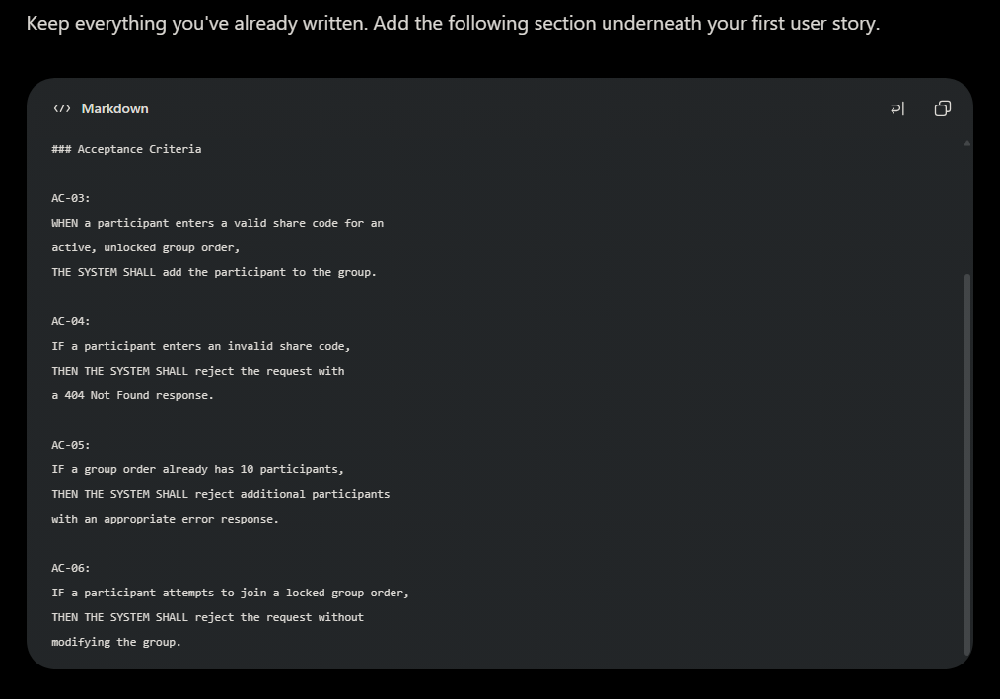
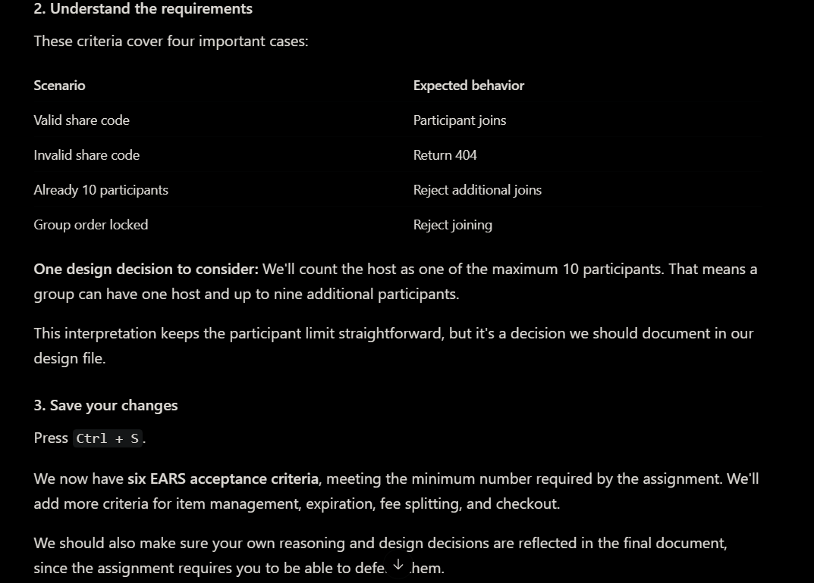
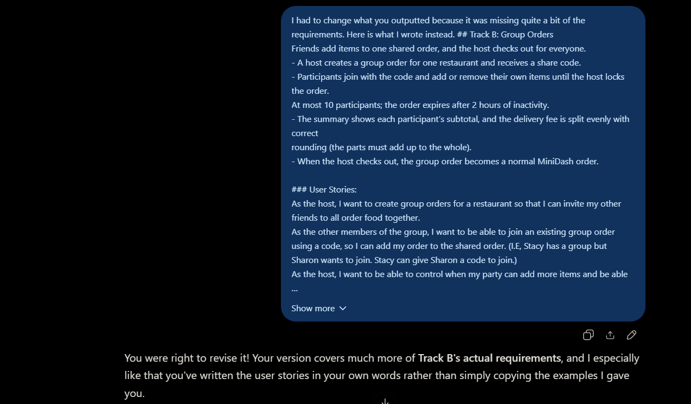

# AI LOG: 

### Entry 1 - Track B Requirement Review
| Field | My Entry |
|---|---|
|Date & Time: | October 29th, 2026, approximately 8:30 PM EDT |
|AI Tool:| ChatGPT |
|Slice:|Commits 2-5 on requirements.md|
|Task:| Defining requirements for Track B: Group Ordering in requirements.md|
|Prompt:|"How would you formulate a response to the requirements of the requirements.md file."|
|What AI Produced:|
When it came to declare the requirements of TRACK B for this project, ChatGPT outputted the absolute bare minimum requirements without taking into account the actual steps necessary to pass.|

|What I Verified:| Compared output against the project document.|
|What I Changed:|After reviewing the output, I then readjusted the requirements further to fix the requirements, add what was missing, and make sure to define the scope further by including the "Out-of-Scope" section to the requirements document.|
|Outcome:|The substantial changes heavily revised what ChatGPT thought were requirements rather than accepting the initial output (which can be found in requirements.md). The revised requirements provide a more complete basis for designing and implementing Track B.|
### Screenshots - Entry #1
**Initial AI Output:**
 

**My Corrections:**

--- 
| Field | My Entry |
|---|---|
| Entry # / Date | 2 / ... |
| Tool, Model, Mode | ... |
| Slice | ... |
| Prompt | ... |
| What the AI produced | ... |
| What I verified | ... |
| What I changed and why | ... |
| Outcome | ... |