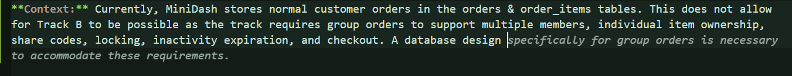
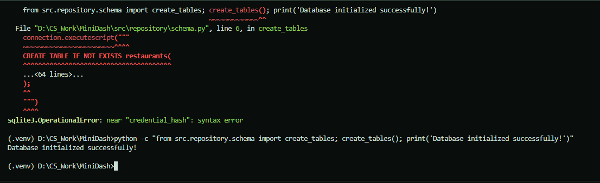

# AI LOG: 

### Entry 1 - Track B Requirement Review
| Field | My Entry |
|---|---|
|Date & Time: | October 29th, 2026, approximately 8:30 PM EDT |
|AI Tool:|ChatGPT 5.5 & Medium Think Time|
|Slice:|Commits 2-5 on requirements.md|
|Task:| Defining requirements for Track B: Group Ordering in requirements.md|
|Prompt:|"How would you formulate a response to the requirements of the requirements.md file."|
|What AI Produced:|When it came to declare the requirements of TRACK B for this project, ChatGPT outputted the absolute bare minimum requirements without taking into account the actual steps necessary to pass.|
|What I Verified:| Compared output against the project document.|
|What I Changed:|After reviewing the output, I then readjusted the requirements further to fix the requirements, add what was missing, and make sure to define the scope further by including the "Out-of-Scope" section to the requirements document.|
|Outcome:|The substantial changes heavily revised what ChatGPT thought were requirements rather than accepting the initial output (which can be found in requirements.md). The revised requirements provide a more complete basis for designing and implementing Track B.|
### Screenshots - Entry #1
**Initial AI Output:**
 

**My Corrections:**

## Entry 2 - Revision of Requirements & Appendix A
--- 
| Field | My Entry |
|---|---|
| Entry # / Date | 2 / Oct 29, 9:30 PM |
| Tool, Model, Mode | ChatGPT 5.5 & Medium Thinking |
| Slice | 6 on requirements.md |
| Prompt | "Adjust requirements to match EARS Acceptance Criteria." |
| What the AI produced | The AI managed to produce and check over the EARS rules to make sure they fit the requirements and formatting. |
| What I verified | I verified that the model covered all the bases when it came to the output and requirements and made sure everything was in-line with the changes necessary. I also double-checked to make sure that the statements were not falsified or hallucinated as GPT prompts like this can happen. |
| What I changed and why | I changed how the rules were worded as they did not fit the requirements before double-checking. |
| Outcome | Requirements of appendix A were met. |

## Entry 3 — Mermaid Design Diagram

| Field | My Entry |
|---|---|
| Entry # / Date | 3 / October 30, ~10:20 AM |
| Tool, Model, Mode | ChatGPT 5.5 & Medium Thinking |
| Slice | 2 |
| Prompt | Help me refine the current mermaid diagram I have to make the relationships make more sense. |
| What the AI produced | The AI managed to clean up the issues that I had when it came to connecting the menu_items table and group_order_items tables together. |
| What I verified | The connections were correct and made sense logically and are understandable in regular "human" english. |
| What I changed and why | I edited the labeling of the keys as ChatGPT failed to do so. |
| Outcome | The mermaid design diagram that exists in 'design.md'. |

## Entry 4 — Architecture Design Record ADR

| Field | My Entry |
|---|---|
| Entry # / Date | 4 / October 30, 10:55 AM |
| Tool, Model, Mode | GitHub Copilot & Low Eagerness |
| Slice | Slice 3 |
| Prompt | "Document the architecture design record for separating group orders from normal orders." |
| What the AI produced | Screenshot Attached. |
| What I verified | I verified the accuracy and completeness of Copilot's output against the listed requirements. |
| What I changed and why | I had to go in and manually document the design records as GitHub Copilot failed to meet the requirements necessary for this project. |
| Outcome | The current ADR documents the design, choices as to why, and explains why we are designing a database to support the group orders features without overly complicating the normal order system, as both can coexist. |
**AI Output:**
 

## Entry 5 — SQL Table Creation

| Field | My Entry |
|---|---|
| Entry # / Date | 5 / October 30, 12:00 PM |
| Tool, Model, Mode | GitHub Copilot & Low Eagerness |
| Slice | 1 from tasks.md |
| Prompt | Inline SQL table creation for the database schema, testing CHECK table-level constraints. |
| What the AI produced | "is_host INTEGER NOT NULL DEFAULT 0, CHECK (is_host IN (0,1)), credential_hash TEXT NOT NULL," |
| What I verified | I verified the correctness of the table creations with the python command `python -c "from src.repository.schema import create_tables; create_tables(); print('Database initialized successfully!')"` |
| What I changed and why | I had to change the formatting of the CHECK constraint to be inline with the is_host column definition as required by SQLite syntax so the table creation would not have a near "credential_hash" error. |
| Outcome | The table creation now succeeds without any errors. |

**Terminal Output from Table Creation Command:**
 

## Entry 6 — Next AI Interaction

| Field | My Entry |
|---|---|
| Entry # / Date | 6 / ... |
| Tool, Model, Mode | ... |
| Slice | ... |
| Prompt | ... |
| What the AI produced | ... |
| What I verified | ... |
| What I changed and why | ... |
| Outcome | ... |

## Entry 7 — Next AI Interaction

| Field | My Entry |
|---|---|
| Entry # / Date | 7 / ... |
| Tool, Model, Mode | ... |
| Slice | ... |
| Prompt | ... |
| What the AI produced | ... |
| What I verified | ... |
| What I changed and why | ... |
| Outcome | ... |

## Entry 8 — Next AI Interaction

| Field | My Entry |
|---|---|
| Entry # / Date | 8 / ... |
| Tool, Model, Mode | ... |
| Slice | ... |
| Prompt | ... |
| What the AI produced | ... |
| What I verified | ... |
| What I changed and why | ... |
| Outcome | ... |