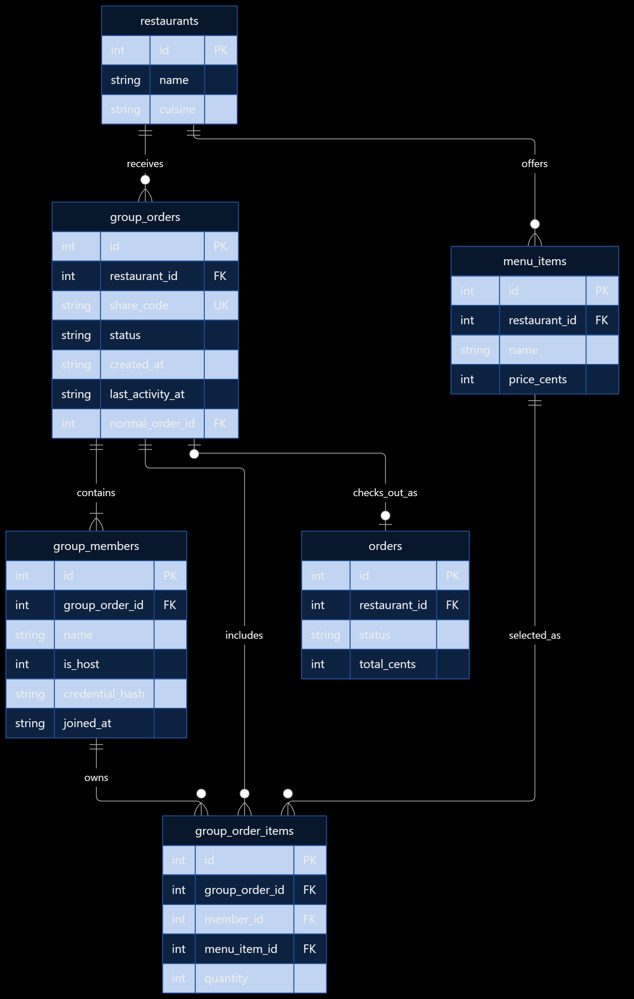

# MiniDash - Track B: Group Orders

## 1. Design Overview

The group orders features will extend the existing MiniDash REST API to allow multiple people to contribute items to one shared restaurant order. The host will create a group order and receives a unique share code. Other members join using that code. Members can add or remove their own menu items while the group order is open. The host can lock the group order to prevent further modifications and then complete checkout. After checkout is accepted, the group order is then considered one normal MiniDash order. 

The implementation will use Python, FastAPI, and SQLite while following the pre-existing layered architecture. 

## 2. Components Affected
- `src/main.py`: Register the group order API routes.
- `src/models.py`: Add data validation models.
- `src/repository/schema.py`: Add group order database tables.
- Normal order functionality: Support group order checkout.

## 3. New Components
The group orders feature will introduce three main components: 
1. Group Ordering Routes:
- Accept HTTP requests relating to group orders
- Validate incoming request data
- Return appropriate HTTP responses.

2. Group Order Service
- Enforce participant limits.
- Validate item ownership.
- Manage locking and expiration.
- Calculate subtotals and delivery fee splits.
- Coordinate checkout

3. Group Order Repository 
- Store group orders in SQLite
- Store members and their menu items
- Retrieve and update group-order records.

The existing restaurant repository will be reused to validate restaurants and menu items. The existing normal order functionality will also be reused during group checkout.

## 4. API Interfaces
The group orders feature will introduce new rest API endpoints using FastAPI.

### Group Creation:
POST /group-orders --> Creates a new group order for one restaurant.
Requests: 
- restaurant_id
- host_name
Response:
- group_order_id
- share_code
- status (Open/Closed) as a bool
- host identifier

### Joining a Group
POST /group-orders/{code}/join
This will allow other users to join an existing group using a valid share code.
Request:
- member_name
Response:
- member_id
- group_order_id
- status
Restrictions:
- A maximum of 10 members, including the host.
- Joining is prohibited after locking or expiration.
### Adding Items
POST /group-orders/{code}/items
Adds a menu item to a member's group order.
Request:
- member_id
- menu_item_id
- quantity
Restrictions:
- The group has to be OPEN.
- The item MUST exist and belong to the group's restaurant.
- Members can only modify THEIR OWN items.
### Removing Items
DELETE /group-orders/{code}/items/{item_id}
Removes an item from a member's group order.
Request:
- member_id of the person requesting
Restrictions:
- The group MUST be OPEN.
- The item MUST BELONG to that member.
### Viewing the Summary
GET /group-orders/{code}/summary
Returns:
- Members and their individual subtotals
- Each member's share of the delivery fees.
- Total amount due per person.
- Overall order total.
Delivery Fee:
- Fixed at 1595 cents (or $15.95USD for simplicity.)
- Split evenly using integer cents.
- Remaining cents are distributed to the members in a consistent order.
### Locking Group
PATCH /group-orders/{code}/lock
Allows the host to lock the group order.
Request: Host Authorization Credentials 
Response: Updated Group Status (LOCKED or UNLOCKED)
Restrictions:
- Only the host can lock an order.
- Once locked, members cannot join or modify orders.
### Checkout
POST /group-orders/{code}/checkout
Allows the host to place the final group order.
Request: 
- delivery address
- host authorization credentials
Response:
- Normal MiniDash orderID
- Final order total
- Group status (Checked_Out)
Restrictions:
- Only the host can check out.
- The group must be LOCKED before checking out.
- Checkout must not create duplicate normal orders.
## 5. Database Design
The GROUP ORDERS feature will add three SQLite tables: group_orders, group_members, and group_order_items.

### group_orders
- id: INTEGER PRIMARY KEY
- restaurant_id: INTEGER, foreign key to restaurants
- share_code: TEXT UNIQUE NOT NULL
- status: TEXT NOT NULL
- created_at: TEXT NOT NULL
- last_activity_at: TEXT NOT NULL
- normal_order_id: INTEGER, Nullable foreign key to orders

*The status can be OPEN, LOCKED, CHECKED_OUT, or EXPIRED.The last_activity_at timestamp determines whether the group has been inactive for two hours. All timestamps use UTC. normal_order_id is stored so we can remember which regular order was created at checkout.*
### group_members
- id: INTEGER PRIMARY KEY
- group_order_id: INTEGER, foreign key to group_orders
- name: TEXT NOT NULL
- is_host: INTEGER NOT NULL
- credential_hash: TEXT NOT NULL
- joined_at: TEXT NOT NULL

*The host counts towards the maximum of 10 members; each member gets a private credential used to verify their identity when modifying their own items.*
### group_order_items
- id: INTEGER PRIMARY KEY
- group_order_id: INTEGER, foreign key to group_orders
- member_id: INTEGER, foreign key to group_members
- menu_item_id: INTEGER, foreign key to menu_items
- quantity: INTEGER NOT NULL
*Each item belongs to a specific member.*
### Data Integrity Rules:
1. Each group belongs to exactly one restaurant. (Many to 1)
2. A share must be unique.
3. A group may contain at most 10 members.
4. Each group has exactly one host.
5. Item quantities MUST be positive.
6. Menu items must belong to the group's restaurant.
7. Members may modify their items ONLY.
8. A completed group references one normal MiniDash order.
9. A group can be checked out only once.
10. Delivery fees are calculated using integer cents.
## 6. Database Entity Relationship Diagram
The diagram below illustrates how group orders, members, and their selected menu items connect to the existing MiniDash database. The diagram was created by me with refining from ChatGPT for a better understanding of the relationships and how they interact with one another.

